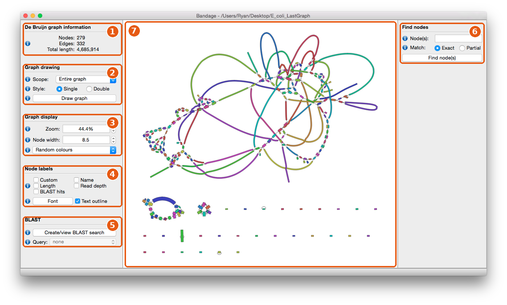
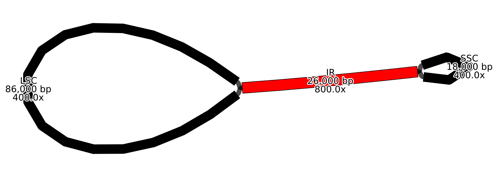
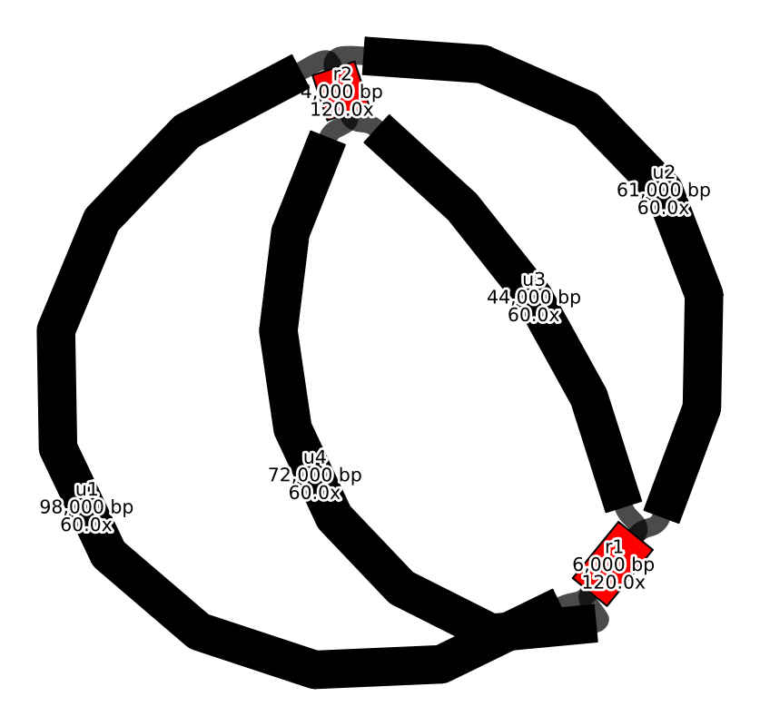

# Biodiversity Genomics 2026W

## Genome quality control and assembling organelle genomes


Today has two parts. First we check how good our hifiasm assemblies are (gfastats, BUSCO, Bandage). Then we assemble the mitochondrial and plastid genomes with oatk and look at them in GeSeq and Bandage.

## 2. Getting basic stats with gfastats

Last week each team produced an assembly(s) with hifiasm. We must have done something right because the assemblies were successfully completed. In this walkthrough we use the *D. superbus* assembly as the example.

The most important files for now are (for your own species, use your team's files and prefix):

```text
Dsuperbus3_run2.bp.p_ctg.gfa
Dsuperbus3_run2.bp.hap1.p_ctg.gfa
Dsuperbus3_run2.bp.hap2.p_ctg.gfa
```

In order, these are (1) the primary assembly of the diploid genome, (2) the primary assembly of haplotype 1, and (3) the primary assembly of haplotype 2. For the rest of this exercise we will focus only on the diploid assembly and the assembly of haplotype 1.

The assembled contigs are found in `.gfa` files (Graphical Fragment Assembly format), as these are the contigs that result from traversing the string graph made by hifiasm. The programs that we want to use (`gfastats` here and BUSCO in the next section) take fasta files as input, so the first thing we need to do is convert the `.gfa` files to fasta. In a hifiasm `.gfa` file, every line that starts with `S` holds one contig: the second column is the contig name and the third column is its sequence. The `awk` command below picks out these lines and prints each one as a fasta record. 

First find the module and make sure it can be loaded properly. Remember that we can use:

```text
module avail gfastats
```

to check on its availability, and:

```text
module load gfastats
```

If you get an error telling you that you can't load the module, check how LiSC writes its name in the output of `module avail`. You must be precise in how you write the name of the module, including upper and lower case letters!

**IMPORTANT: Don't run anything with `gfastats` yet.** Remember that it is always best to run anything on LiSC with a submission script. The way we convert the assembly and run `gfastats` is as follows:

```text
module load gfastats
awk '/^S/{print ">"$2"\n"$3}' /lisc/data/scratch/botany/wickett_lab/Dasha/D_superbus_assembly/hifiasm_run2/Dsuperbus3_run2.bp.hap1.p_ctg.gfa > Dsuperbus3_run2.bp.hap1.p_ctg.fa
gfastats Dsuperbus3_run2.bp.hap1.p_ctg.fa > Dsuperbus3_run2.bp.hap1.p_ctg.stats
```

**IMPORTANT:** If you are working on another species, replace the input path and the file names with your own. The `awk` command writes the fasta file into your current directory, and `gfastats` writes its statistics into the `.stats` file.

Now that you know how to run `gfastats` you can write a submission script. Make sure you have navigated into your personal working directory. Once there, use `nano` to write a submission script. It should look something like this:

```bash
#!/bin/bash
#
#SBATCH --job-name=gfastats
#SBATCH --cpus-per-task=2
#SBATCH --mem=16GB
#SBATCH --partition=basic
#SBATCH --mail-type=ALL
#SBATCH --time=0-00:30:00

module load gfastats

awk '/^S/{print ">"$2"\n"$3}' /lisc/data/scratch/botany/wickett_lab/Dasha/D_superbus_assembly/hifiasm_run2/Dsuperbus3_run2.bp.p_ctg.gfa > Dsuperbus3_run2.bp.p_ctg.fa
gfastats Dsuperbus3_run2.bp.p_ctg.fa > Dsuperbus3_run2.bp.p_ctg.stats

awk '/^S/{print ">"$2"\n"$3}' /lisc/data/scratch/botany/wickett_lab/Dasha/D_superbus_assembly/hifiasm_run2/Dsuperbus3_run2.bp.hap1.p_ctg.gfa > Dsuperbus3_run2.bp.hap1.p_ctg.fa
gfastats Dsuperbus3_run2.bp.hap1.p_ctg.fa > Dsuperbus3_run2.bp.hap1.p_ctg.stats
```

Compare the results from the diploid assembly and the haplotype 1 assembly. What do you notice? Do the results make sense? If you produced several assemblies please compare them as well. 

What do the N50 and L50 (and N90 and L90) stats mean? What is its estimated genome size, and how does it compare to your GenomeScope estimate? How well do you think hifiasm did with the assembly?

## 3. Gene completeness with BUSCO

gfastats tells us how contiguous the assembly is, but not whether the genes are there. BUSCO searches the assembly for a set of genes that are expected in a single copy in nearly every species of a lineage (Benchmarking Universal Single-Copy Orthologs). A good assembly has a high percentage of complete, single-copy BUSCOs; many duplicated BUSCOs suggest both haplotypes ended up in one assembly and many fragmented or missing BUSCOs point to gaps or errors.

BUSCO needs a fasta file as input. Use the haplotype 1 fasta file (`Dsuperbus3_run2.bp.hap1.p_ctg.fa`) that you made with `awk` in section 2.

To check that BUSCO runs, try it on a small test file first. `-m genome` tells BUSCO that the input is a genome assembly, and `--auto-lineage` lets BUSCO pick the best lineage dataset for your species on its own:

```text
module load BUSCO/6.0.0-foss-2023a
busco -i <your assembly fasta> -m genome --auto-lineage
```

For your own assembly, BUSCO needs a few hours:

```bash
#!/bin/bash
#
#SBATCH --job-name=busco_hap1
#SBATCH --cpus-per-task=16
#SBATCH --mem=32GB
#SBATCH --partition=basic
#SBATCH --mail-type=ALL
#SBATCH --time=0-08:00:00

module load BUSCO/6.0.0-foss-2023a

busco -i Dsuperbus3_run2.bp.hap1.p_ctg.fa -m genome --auto-lineage -c 16 -o busco_Dsuperbus3_run2_hap1
```

When the job is finished, open the `short_summary*.txt` file in the output directory. Which lineage did BUSCO choose? What percentage of BUSCOs is complete (C), and how many of those are single-copy (S) or duplicated (D)?

## 4. Looking at the assembly graph in Bandage

Bandage draws an assembly graph: each node is a sequence (here a contig) and each edge shows how two sequences connect. It shows things that summary statistics hide, such as contigs that hifiasm could not join and tangles caused by repeats. Download Bandage for your computer from https://github.com/rrwick/Bandage/releases (BandageNG, https://github.com/asl/BandageNG, is an actively maintained fork that also works).

hifiasm writes every graph twice: with sequences (`*.gfa`) and without (`*.noseq.gfa`). The noseq version only stores contig names, lengths and connections, so it is a small fraction of the size and much quicker to download and draw. Download using VSCode.

If you are curious, also download `Dsuperbus3_run2.bp.r_utg.noseq.gfa`, the raw unitig graph before hifiasm resolved it into contigs. It is much larger and messier, and Bandage may need several minutes to draw it.

### Walkthrough of the Bandage interface



*The Bandage main window (screenshot from the Bandage wiki, Ryan Wick, GPL-3.0). Numbers refer to the steps below.*

1. **Graph information.** Load your graph with *File → Load graph*. This panel then shows the number of nodes, edges and the total length. Does the total length match your gfastats output?
2. **Graph drawing.** Nothing is drawn until you press **Draw graph**. Keep *Scope: Entire graph* for small graphs; for large graphs choose *Around nodes* and type a contig name to draw only its neighbourhood.
3. **Graph display.** Zoom, node width and the colour scheme. *Random colours* makes neighbouring contigs easy to tell apart. *Colour by depth* only works for graphs that store read depth, such as the oatk graphs later today.
4. **Node labels.** Tick *Name* and *Length* to print them on the nodes.
5. **BLAST.** Optional: search a gene sequence against the graph to see where it lands.
6. **Find nodes.** Type a contig name (e.g. `ptg000001l`) and press *Find node(s)* to jump to it.
7. **Graph canvas.** Click a node to select it, drag nodes to move them, use Ctrl + mouse wheel to zoom and Ctrl + left-click-drag to pan. Save what you see with *File → Save image (current view)* or *File → Save image (entire scene)*.


## 5. Assembling organelle genomes with oatk

oatk assembles mitochondrial and plastid genomes directly from the HiFi reads. Every cell has many copies of its organelle genomes, so organelle k-mers have much higher coverage than nuclear ones, and oatk uses a coverage cut-off to throw away the nuclear sequence. It then uses databases of mitochondrial and plastid genes (OatkDB) to recognise which parts of the remaining graph belong to which organelle and finds the best path through each.

Load the modules:

```text
module load HMMER/3.4-gompi-2025b
module load Oatk
```

and write a submission script (the run takes around 10 minutes for *D. serotinus*):

```bash
#!/bin/bash
#
#SBATCH --job-name=oatk
#SBATCH --cpus-per-task=8
#SBATCH --mem=32GB
#SBATCH --partition=basic
#SBATCH --mail-type=ALL
#SBATCH --time=0-01:00:00

module load HMMER/3.4-gompi-2025b
module load Oatk

oatk -k 1001 -c 100 -t 8 \
    --nhmmscan /lisc/opt/sw/software/HMMER/3.4-gompi-2025b/bin/nhmmscan \
    -m /lisc/data/scratch/course/2026w300485/oatk/OatkDB/v20230210/angiosperm_mito.fam \
    -p /lisc/data/scratch/course/2026w300485/oatk/OatkDB/v20230210/angiosperm_pltd.fam \
    -o test \
    /lisc/data/scratch/course/2026w300485/Dserotinus2.hifi_reads.fasta
```

What the options mean:

- `-k 1001` is the syncmer (k-mer) size; 1001 is the default.
- `-c 100` is the coverage cut-off. Syncmers with lower coverage are removed, which filters out the nuclear genome. The oatk authors suggest 5–10 times the nuclear coverage; what was the coverage of your data in GenomeScope?
- `-t 8` is the number of threads (match it to `--cpus-per-task`).
- `--nhmmscan` is the path to the HMMER program that oatk uses to search for genes, we provided correct path for you;
- `-m` and `-p` are the gene profile databases for the mitochondrion and the plastid (here for angiosperms), please don't change these paths;
- `-o <prefix>` is the prefix of all output files; choose a name that makes clear what the files are.
- The last argument is the file with the HiFi reads.

The most important output files are:

```text
test.mito.ctg.fasta    the mitochondrial contigs
test.mito.gfa          the graph of the mitochondrial genome
test.pltd.ctg.fasta    the plastid contigs
test.pltd.gfa          the graph of the plastid genome
```

The fasta headers tell you whether oatk could close a contig into a circle (`circular=true`) or not:

```text
grep ">" test.mito.ctg.fasta test.pltd.ctg.fasta
```

How long are your mitochondrial and plastid genomes? Are they circular?

## 6. Visual inspection

Download your mitochondrial assembly (`test.mito.ctg.fasta`) and do the same for the plastid if you like (`test.pltd.ctg.fasta`).

### Annotating the mitochondrial genome with GeSeq

GeSeq annotates organelle genomes in the browser: it compares your sequence with reference organelle genomes to find protein-coding and rRNA genes, predicts tRNAs, and then draws a circular gene map with OGDRAW. The defaults are set up for plastids, so a few settings have to be changed for a mitochondrion. Open https://chlorobox.mpimp-golm.mpg.de/geseq.html

### Optional: the organelle graphs in Bandage

Download `test.mito.gfa` and `test.pltd.gfa` and open them in Bandage. oatk stores read depth in its graphs, so set the colour scheme to *Colour by depth* and tick *Name*, *Length* and *Depth* under node labels.

The plastid usually looks like the first example below: a large single-copy region (LSC) and a small single-copy region (SSC) joined by one node with about twice the depth of its neighbours. That node is the inverted repeat (IR); it exists twice in the genome, but the assembler cannot tell the two copies apart, so it draws one node and reads it twice.



*Toy example of a typical plastid graph, drawn in Bandage and coloured by depth (red = double depth).*

Plant mitochondrial genomes are usually messier, like the second example. They contain repeats that recombine, so the same genome exists in several arrangements in the cell. The repeats show up as short nodes with higher depth where several paths meet. A graph like this is real biology, not a failed assembly.



*Toy example of a plant mitochondrial graph: two repeats (r1, r2) with double depth connect four single-copy regions.*

What do your graphs look like? Can you find the inverted repeat in the plastid? How many repeat nodes does your mitochondrial graph have?

## 7. Save plots for your final report

**Don't forget to keep a record of everything you have done, and be sure to keep the figures somewhere where you can easily find them. This will all be included in your protocol.** From today, keep at least the gfastats output for the diploid and haplotype 1 assemblies, the BUSCO `short_summary*.txt`, a Bandage image of your assembly graph, the GeSeq/OGDRAW map of your mitochondrial genome, and any Bandage images of the organelle graphs you like.

## Further reading

- Galaxy VGP tutorial, assembly evaluation: https://training.galaxyproject.org/training-material/topics/assembly/tutorials/vgp_genome_assembly/tutorial.html#assembly-evaluation
- Galaxy ERGA post-assembly QC: https://training.galaxyproject.org/training-material/topics/assembly/tutorials/ERGA-post-assembly-QC/tutorial.html
- Eukaryotic genome assembly course: https://eukaryotic-genome-assembly.github.io/
- Sanger Tree of Life assembly pipeline: https://github.com/sanger-tol/genomeassembly
- gfastats: https://github.com/vgl-hub/gfastats
- Bandage wiki: https://github.com/rrwick/Bandage/wiki
- oatk: https://github.com/c-zhou/oatk
- GeSeq documentation: https://chlorobox.mpimp-golm.mpg.de/gs_documentation.html
